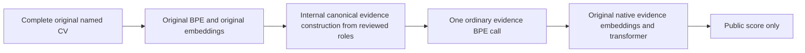

# NameGuard: literature-reviewed preprint and reproducible artifact

**Research prototype, version 0.3.0.** This new folder preserves the efficient
study's frozen model code and measurements. It adds a **25-source literature
review**, in-text citations, BibTeX, source/version notes, a claim/evidence ledger
and executable mathematical counterexamples. It does not add GPU measurements
or train an adapter. The review is targeted and narrative, not exhaustive.

- [Revised manuscript](paper/manuscript.md) and [standalone PDF](output/pdf/nameguard-literature-preprint-draft.pdf).
- [Full literature review](literature/review.md), [BibTeX](literature/references.bib), [source locators and inspection depth](literature/references.json), [search record](literature/search-log.json).
- [Claim/evidence ledger and next-study design](docs/CLAIM-EVIDENCE.md), [release notes](RELEASE-NOTES.md).
- [Mathematical counterexamples](scripts/scientific_claims.py): equal outputs can
  retain names; zero covariance can retain labels; finite tests can miss new
  names; reviewers can share mistakes; equivalent internal/external Q paths match.

**How it works:** the complete named source is tokenized and embedded first.
Explicit code inside the backend then constructs reviewed evidence Q and runs
the unchanged model on its native evidence tokens. The scoring path cannot use
excluded identity text when Q is fixed. Roles come from source-bound review;
this is structural information routing, not learned whole-model name erasure.
Original model files, weights and ordinary evidence computation remain intact.

**Critical baseline:** an external canonicalizer providing the same Q to the same
scoring model has identical outputs. Raw embedding first adds no mathematical
score-isolation benefit. Internal placement is an implementation boundary, not
evidence of novelty. No speed superiority over optimized external anonymization
has been measured; the 4.10x figure below compares the prior scalar service.

**Publication status:** a reviewable technical-report/preprint draft, not an
accepted paper or demonstrated novel algorithm. Independent real semantic
annotation, useful hiring-label evaluation and a matched external-Q baseline
are missing. Other racial proxies and unfair job policies are outside the proof.
The final model retains name knowledge and raw private identity activations.

## Verification

From this directory, with Python 3.10+ (no model needed):

```sh
PYTHONPATH=src python -m unittest discover -s tests -v
python scripts/literature_tools.py
python scripts/scientific_claims.py
python scripts/verify_results.py
python scripts/check_proofs.py  # requires an installed Z3 executable
python scripts/verify_manifest.py
```

The current suite has **63 CPU tests**: the inherited 52 plus 11 claim/citation
checks. Citation lint checks local consistency, not whether source claims are
true. The results below are inherited unchanged, including 108 GPU forwards.
The copied historical build scripts are retained; current entrypoints are
`scripts/build_scholarly_pdf.py` and `scripts/make_preprint_release.py`.
Package metadata is v0.3.0; the shared core's historical `__version__` is kept
unchanged because it belongs to the experimental source freeze.

## Completed results

| Check | Measured result |
|---|---:|
| Transformer token ratio to ordinary BPE of retained evidence | **1.000x** in every example |
| Three original-body scoring lengths | **62 / 63 / 64**, versus scalar **281 / 291 / 284** |
| 32 generated token-corpus cases | **8,457** canonical versus **25,201** scalar tokens |
| Aggregate token reduction in that corpus | **66.44%** |
| Local median service latency | **81.5 ms** canonical versus **334.4 ms** scalar |
| Median paired speedup, 21 pairs | **4.10x** |
| Matched GPU conformance forwards | **108**, zero score differences |
| Direct counterfactual public-stage array comparisons | **3,360**, all equal |
| Native evidence hidden/vocabulary checks | **6**, all equal |
| Deliberately omitted registered identity references | **108/108 rejected** |
| Conflicting reviewed payload pairs | **36/36 rejected** |
| CPU tests | **52 pass**, including 2,000 Unicode property cases |

The token corpus is generated multilingual/repetition text, not real applicant
data. Conformance uses three synthetic evidence bodies, 12 name strings and
three source/segmentation variants: 108 repeated forwards, not independent
population observations. Three establish references; the other 105 compare
32 public stages each. The public stages include token IDs, embeddings, 28
blocks, final normalization and the final-position full vocabulary readout.

Timing includes verification, tokenization, embeddings, inference and per-call
model checks, with two warm-ups per method/body and seven shuffled-order paired
repeats. Model loading and review signing are excluded. This local service-level
comparison is not a guaranteed speedup across hardware or input lengths.

## Why token counts return to normal

Let T be the original BPE tokenizer and Q the exact concatenation of retained
evidence text. The scalar version used `concat(T(c) for c in Q)`, preventing
subword merges. The new scoring path uses **T(Q)** once, so its length is exactly
`len(T(Q))`. Annotation splits cannot matter because they are joined before
that tokenizer call. [The mathematical derivation](docs/MATHEMATICS.md) includes
the factorization theorem, alternatives, cost analysis and annotation-error bound.



Original-source embedding visits are additional work: the new path uses
`len(T(X)) + len(T(Q))` embedding visits and `len(T(Q))` transformer positions.
For the three John Miller reference CVs, raw-plus-canonical embedding counts
are 133/135/137, versus scalar source embeddings of 326/336/329. The **1x claim
is for scoring-transformer length**, not all tokenizer/embedding operations.

## Stronger identity annotations

The review layer requires exact original source offsets/text, an explicit
identity registry, source-bound retained meanings for same-spelled skills or
clients, a resolved review status and **two distinct configured credentials
endorsing the exact same payload**. Known normalized registry matches left
unexplained, conflicting approvals, stale spans, overlap and tampering reject.

This provides mechanical checks and authenticated agreement. It does not
establish that two independent humans reviewed the source or that their shared
judgment is correct. The annotation experiment uses a generator role oracle
and simulated credentials. An unregistered-alias negative control deliberately
survives both signatures; it remains a documented semantic limitation.

Follow [the review/adjudication procedure](docs/ANNOTATION-PROTOCOL.md) for actual
input preparation. Candidate generation remains unresolved until review.
Character agreement/kappa are diagnostic tools, not a semantic truth oracle.

## Quick verification without a model

Python 3.10+ and the standard library suffice for CPU tests and saved-record replay:

```sh
PYTHONPATH=src python -m unittest discover -s tests -v
python scripts/verify_results.py
python scripts/verify_manifest.py
```

With an installed Z3 executable:

```sh
python scripts/check_proofs.py
```

Z3 checks a small conditional factorization lemma and a tokenizer countermodel.
It does not verify Python/MLX/GPU execution or semantic roles end to end. The
CPU verifier reconstructs frozen source hashes, coverage, counts and timing
summaries from saved records; it is not independent GPU re-inference.

## Run the actual internal model

Use Apple Silicon with `requirements-mlx.txt` and a local checkpoint matching
`data/tested-checkpoint-manifest.json` and the pinned parameter digest. No base
weights are bundled, downloaded or modified. Other checkpoint exports are
intentionally rejected; see [reproduction details](docs/REPRODUCIBILITY.md).

```sh
python scripts/demo.py --checkpoint /path/to/pinned-qwen \
  --manifest data/tested-checkpoint-manifest.json \
  --names 'John Miller' 'Mohammed Hassan' 'Previously Unseen Name'
```

This is a synthetic demo with generated exact-role text and two machine keys;
it is not evidence of real reviewer accuracy. It gives identical unrounded
scores for the same retained evidence. The serving API is
`nameguard.canonical_backend.create_native_service`; create packets with
`proposal_from_spans`, `endorse` and `packet` after actual review. The demo
and [annotation protocol](docs/ANNOTATION-PROTOCOL.md) show how those fit together.

Model parameters, checkpoint files and ordinary native-evidence computation
are preserved. Native mistakes remain. The new scores need not equal the old
scalarwise model's scores, because that model used a different tokenization.
There is no claim of accurate hiring or preserved arbitrary named-CV outputs.

## Preprint and portfolio

- [Preprint manuscript](paper/manuscript.md) and [rendered PDF](output/pdf/nameguard-literature-preprint-draft.pdf).
- [Mathematics](docs/MATHEMATICS.md), [annotation protocol](docs/ANNOTATION-PROTOCOL.md), [hardening ledger](docs/HARDENING.md).
- `results/gpu.json`, `tokens.json`, `timings.json`, `annotations.json`, `verification.json`: actual measurements and negative controls.
- `audit/design.json`: frozen source hashes, hypotheses, timing protocol and limits.
- `src/nameguard/canonical_backend.py`: real internal canonical path.
- `src/nameguard/annotations.py`: authenticated consensus and registered-reference checks.
- `LICENSE`, `CITATION.cff`, `pyproject.toml`: reusable software and citation metadata.

Suggested portfolio claim: **“Reduced a role-isolated frozen-LLM scorer to native
evidence token counts, measured a 4.1x local speedup, tested exact activation
noninterference on Apple GPU, and hardened source-bound annotation review with
explicit unresolved semantic limits.”**

This is a transparent preprint draft and engineering artifact, not a
peer-reviewed publication, independent replication or established novel theory.
It is not ready for consequential hiring deployment. Academic submission still
requires author review, suitability to a venue and stronger independent studies.

Research references: [tokenizer pipeline](https://huggingface.co/docs/tokenizers/v0.20.3/en/pipeline),
[BPE subword encoding](https://aclanthology.org/P16-1162/), and
[inter-coder agreement](https://aclanthology.org/J08-4004/).
