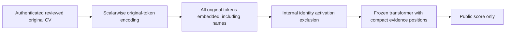

# NameGuard: authenticated name-channel noninterference

**Research prototype + preprint draft.** This project asks a narrow question:
can changing an explicitly designated applicant name alter a model's score when
the retained CV evidence stays fixed? It provides a conditional architectural
proof, solver-checked algebra and an actual frozen-Qwen GPU experiment.

**It does not prove automatic removal of every name reference in arbitrary raw
CVs, whole-model name unlearning, fair hiring outcomes or grading accuracy.**
Identity-role correctness remains a trusted human/data-contract premise.

## What this version adds

The earlier prototype left role records unauthenticated, exposed an audit option,
and tokenized evidence fields in a way that depended on field boundaries. This
version adds authenticated immutable source-bound review packets, a public
score-only API, segmentation-independent encoding, fresh-cache inference,
model-graph/parameter checks, locks, failure poisoning and name-independent
ranking ties. [The weakness ledger](docs/WEAKNESSES.md) lists 15 specific issues,
their tests and the limits still unresolved.



The model excludes identity **after embedding, inside the computation**. It
still needs role metadata. This is structural isolation, not an autonomous
learned name detector. Authentication makes subsequent tampering detectable;
it cannot make an incorrect review correct.

## Exact claim

For any two accepted, authentically reviewed inputs D,D' under the same trusted
configuration:

```
concatenated_evidence(D) = concatenated_evidence(D')
    => all downstream scoring activations are equal
    => PublicScore(D) = PublicScore(D').
```

The claim covers new name values, lengths, scripts, extra identity fields and
different evidence segmentation within supported limits. It does not require
the score to grade the CV correctly. See [the theorem](docs/THEOREM.md) and
[the threat model](docs/THREAT-MODEL.md).

## Completed measurements

| Test | Result |
|---|---:|
| Actual Qwen1.5B GPU forwards | 108 |
| Direct public tensor comparisons | 3,255, all equal within fixed-evidence groups |
| Name/evidence-segmentation score changes | 0 |
| Source/role/reviewer/policy/hash tampering variants | 5/5 rejected |
| Original-tokenizer segmentation failure examples | 4/4 reproduced; revised codec matches |
| CPU tests | 30 pass, including 2,000 seeded Unicode property cases |
| Safe symbolic gather specifications | 2 return UNSAT |
| Deliberately unsafe specifications | 2 return SAT |
| Runtime smoke | Lock, poisoning, module-drift rejection and final integrity pass |

The experiment uses **three synthetic evidence bodies × 12 identity strings ×
three segmentation/insertion variants**. Three forwards establish reference tensors; 105 counterfactual forwards compare
31 stages each (3,255 comparisons), and three additional native-path checks
compare final hidden tensors. There are 3,348 observed public-stage tensors in
total; observed tensors and nontrivial comparisons are different counts.
These are repeated conformance checks,
not 108 independent people or a population fairness estimate. No real applicant
CVs, race labels, model weights or reviewer secrets are published.

The strengthened codec costs tokens: ordinary BPE used 59/60/61 evidence tokens,
versus 271/281/274 scalarwise tokens in the three examples. It can change task
accuracy. Unchanged base parameters do not imply unchanged native grading,
latency or memory use. The score remained nonconstant across evidence bodies;
we did not substitute a constant-output model.

## Quick start: CPU, no model needed

Python 3.10+; the contract and runtime tests use only the standard library:

```sh
PYTHONPATH=src python -m unittest discover -s tests -v
python scripts/verify_results.py
python scripts/verify_manifest.py
```

With a Z3 executable installed:

```sh
python scripts/check_proofs.py
```

The solver checks abstract integer-array specifications. It does **not** verify
the complete Python/MLX implementation, tokenizer, GPU kernels or role semantics.
The read-only result verifier checks saved source hashes, coverage and summary
records; it does not reconstruct omitted large tensors or re-run GPU inference.

## Actual model inference

Use the pinned Apple Silicon dependencies in `requirements-mlx.txt`, or install
the package's `mlx` extra. The tested model is a specific original, unadapted
affine-four-bit Qwen2.5-1.5B runtime, identified by the parameter digest in
`src/nameguard/mlx_backend.py`. Other parameters are intentionally rejected.
Set up the required local model under its original license; weights are not
included. Supply a trusted file manifest in the format of `data/manifest-schema.json`.

```python
import secrets
from nameguard.contracts import sign_review
from nameguard.serialized_backend import create_service

# Trusted reviewer/operator setup; never expose a signing endpoint to applicants.
key = secrets.token_bytes(32)  # Store securely if persistent operation is needed.
nodes = [
    {"role": "evidence", "text": "Applicant: "},
    {"role": "identity", "text": "Any unseen name"},
    {"role": "evidence", "text": "\nFour years paid Python work. A yes; B no. Answer:"},
]
wire = sign_review(nodes, reviewer="reviewer1", key=key)
service, verify_close = create_service(MODEL_PATH, TRUSTED_MANIFEST_PATH, {"reviewer1": key})
try:
    result = service.score(wire)
    print(result.as_dict())  # Only margin and conditional_A_probability.
finally:
    print(verify_close())
```

Every name-bearing alias/contact/reference must be labeled identity if its
changes are to be covered. The rest is retained exactly as Unicode text; there
is no automatic proof of role completeness. The public A/B probability is a
constrained language-model score, not a calibrated employment probability.

To rerun the frozen GPU design, use a new copy/output folder (completed results
are never overwritten):

```sh
python scripts/gpu_study.py --checkpoint /path/to/pinned-qwen \
  --manifest /path/to/trusted-checkpoint-manifest.json
python scripts/runtime_smoke.py --checkpoint /path/to/pinned-qwen \
  --manifest /path/to/trusted-checkpoint-manifest.json
```

## Research and portfolio materials

- [Preprint draft](paper/manuscript.md), with abstract, proof, experiments, failures and limitations.
- [Rendered report](output/pdf/nameguard-preprint-draft.pdf).
- [Weakness ledger](docs/WEAKNESSES.md), [theorem](docs/THEOREM.md), [threat model](docs/THREAT-MODEL.md).
- `results/gpu.json`, `runtime-smoke.json`, `proofs.json`: complete synthetic measurements.
- `audit/`: frozen source plans, solver specifications, checksums and provenance.
- `reference/legacy_model.py`: preserved earlier code for the reproduced segmentation regression.
- `SECURITY.md`, `CITATION.cff`, `pyproject.toml`: project metadata and reproducibility boundaries.

Suggested portfolio description: **“Built and adversarially tested a frozen-LLM
scoring prototype with authenticated role annotations, an internal activation
gate and a conditional noninterference proof; reproduced segmentation leaks,
validated fixes on Apple GPU, and documented unresolved semantic trust.”**

Do not describe this as universal racial-bias removal from raw CVs or a
peer-reviewed hiring system. The work is an engineering/research artifact;
independent replication and academic novelty have not been established. All
results in this folder use generated text, unlike the real-dataset work in the
parent repository. This publication does not redistribute those datasets.

Methodological references: [information-flow integrity/confidentiality](https://www.cs.cornell.edu/andru/papers/usenix07-html/paper.html),
[counterfactual fairness](https://arxiv.org/abs/1703.06856),
[linear concept erasure](https://arxiv.org/abs/2306.03819), and
[Python HMAC guidance](https://docs.python.org/3/library/hmac.html).
These motivate distinctions and implementation choices; this is not a
reproduction of their full guarantees.
